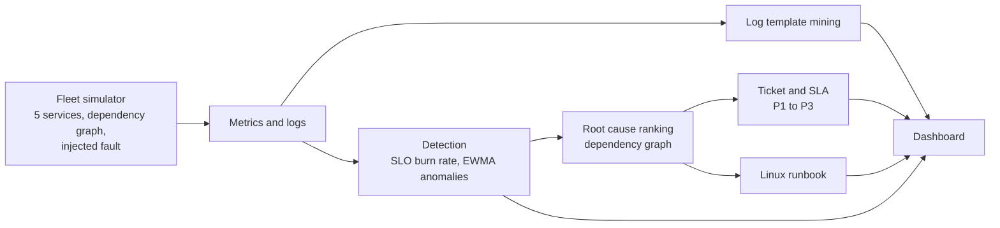

# OpsLens

**Cloud incident console.** OpsLens simulates a small fleet of services, injects a fault,
and then does what an on-call engineer does: detect it, work out the root cause, open a
ticket with a deadline, and point to the Linux runbook that fixes it.

**Live demo:** https://opslens-avl5.onrender.com
(free tier hosting, so the first load can take up to a minute)

<!-- Add a screenshot: save it as docs/screenshot.png, then uncomment the next line -->
<!--  -->

## What it does

Pick a fault scenario and press **Run scenario**. OpsLens then shows:

- **Error rate chart** for every service, with the fault start and first alert marked.
- **Incident and ticket** with a P1 to P3 severity, time to detect, respond by and resolve by.
- **Root cause ranking** that puts the faulty service first and explains why.
- **New log patterns** that appeared during the incident, with counts.
- **Runbook** of Linux commands for that fault.
- **Alerts** raised along the way: SLO burn rate, latency anomaly and CPU anomaly.
- **Network diagnosis** that runs real DNS, TCP and HTTP checks against any public host and
  says which layer failed and how to fix it.

### Example: database disk full

| Output | Result |
| --- | --- |
| Severity | P1, affecting web, api, auth and db |
| Fault started | minute 240, on db |
| First alert | minute 241, detected in 1 minute |
| Respond by | minute 256 |
| Resolve by | minute 481 |
| Root cause | db ranked first: no affected dependency, 3 affected services depend on it |
| New log pattern | 75 times: could not write block in file base: No space left on device |
| Runbook | df -h, du, journalctl --vacuum-size, then confirm writes succeed |

## How it works



- **Fleet simulator.** Five services (web, api, auth, cache, db) with a dependency graph. A
  scenario injects a fault into one of them, and the failure spreads to the services that
  depend on it.
- **Burn rate alerts.** Alerts follow the multi-window SLO method from the Google SRE
  workbook. A page fires when the error budget burns at 14.4x over 60 minutes and over 5
  minutes. A ticket fires at 6x over 360 minutes and over 30 minutes.
- **Anomaly detection.** An EWMA baseline flags latency and CPU that jump away from normal,
  for example latency of 507 against a baseline of 39.
- **Log template mining.** Variable parts of log lines (numbers, block ids, paths) are
  replaced with placeholders, so thousands of lines collapse into a few patterns. Only
  patterns that are new during the incident are shown.
- **Root cause ranking.** Affected services are ranked by whether they have affected
  dependencies and how many affected services depend on them. The service with no affected
  dependency and the most dependants ranks first.
- **Network diagnosis.** Resolves the host, opens a TCP connection and makes an HTTP request,
  timing each step. It reports the first layer that fails and a suggested fix.

## Tech stack

Python standard library only. No frameworks and no third party packages.
Plain HTML, CSS and JavaScript on the front end, with the chart drawn on a canvas.

## Project structure

```
opslens/
  sim.py           Fleet simulator, dependency graph and fault scenarios
  analyze.py       Detection, root cause ranking, tickets, log patterns, runbooks
  netdiag.py       Real DNS, TCP and HTTP diagnosis
  server.py        HTTP server, API routes and the public host safety check
  static/
    index.html     Dashboard page
```

## API

| Route | Description |
| --- | --- |
| `GET /` | Dashboard |
| `GET /api/run?scenario=<name>` | Run a scenario. Returns chart data, the incident, ticket, root cause ranking, log patterns, runbook and alerts |
| `GET /api/netdiag?host=<host>&port=<port>` | Diagnose a public host. Returns each layer with its result and timing, a verdict and a fix |

## Run it locally

You need Python 3.10 or newer.

```bash
git clone https://github.com/shaikumar11/opslens.git
cd opslens
python -m opslens.server
```

Open http://localhost:8000. To use another port, run `python -m opslens.server 9000`.

## Run the tests

```bash
python -m unittest discover -v
```

## Deployment

Hosted as a Render web service with start command `python -m opslens.server`. Render sets
the `PORT` environment variable, and the server then listens on `0.0.0.0` on that port.
Without `PORT` it only listens on `127.0.0.1`.

## Security note

Network diagnosis makes outgoing connections for whoever uses the page, so it only accepts
hosts whose addresses are all public. Names such as `localhost` and addresses in private,
loopback, link-local or reserved ranges are rejected with a reason. Ports are limited to
1 through 65535.

## Limitations and next steps

- The fleet is simulated. Metrics and logs are generated, not collected from real servers.
- The network diagnosis runs from the server's location, so results can differ from what
  you would see from your own machine.
- Next: a bring your own metrics mode that reads real Prometheus data, saved incident
  history, and a timeline view that replays the incident minute by minute.
